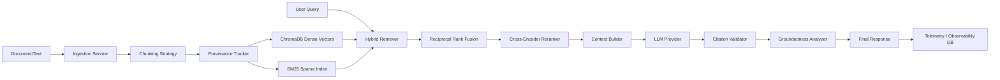

# System Architecture

The RAG Observability Lab is a production-oriented Retrieval-Augmented Generation (RAG) platform with deep tracing and observability. It separates ingestion, retrieval, and generation into distinct services while maintaining granular telemetry across the entire pipeline.

## System Overview

## Data Flow

### 1. Ingestion Pipeline
Raw text is processed by an Ingestion Service that applies a rolling chunking strategy. Each chunk is tagged with explicit provenance (document ID, start index, end index) before being embedded into dense vectors (stored in ChromaDB) and sparse term frequencies (indexed in BM25 via Rank_BM25).

### 2. Retrieval Pipeline
A query triggers a Hybrid Retrieval process:
- ChromaDB performs Approximate Nearest Neighbors (ANN) to return semantic dense matches.
- The BM25 index performs exact keyword matching to return sparse matches.
- Reciprocal Rank Fusion (RRF) algorithmically combines the two lists.
- A Cross-Encoder reranker scores the top-N results to maximize relevance.

### 3. RAG Generation Pipeline
The top-K reranked documents form the context. The LLM is strictly prompted to use the provided evidence. A Citation Validator enforces that every output claim references a specific document chunk. A Groundedness Analyzer determines if the claim is fully supported or if the LLM should abstain.

### 4. Observability Data Flow
The `RAGService` executes the query pipeline wrapped in OpenTelemetry spans. Every stage (retrieval time, token usage, groundedness scores) logs telemetry to a persistent SQLite database. The frontend fetches these traces to visualize pipeline bottlenecks.
